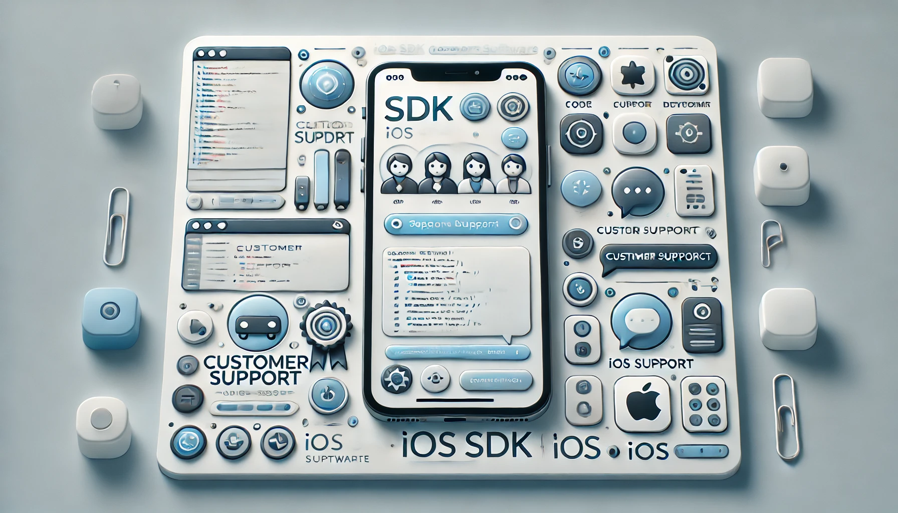

# releasebird-ios-sdk

[](https://travis-ci.org/czillmann/releasebird-ios-sdk)
[](https://cocoapods.org/pods/releasebird-ios-sdk)
[](https://cocoapods.org/pods/releasebird-ios-sdk)
[](https://cocoapods.org/pods/releasebird-ios-sdk)

## Example

To run the example project, clone the repo, and run `pod install` from the Example directory first.

## Requirements

## Installation

releasebird-ios-sdk is available through [CocoaPods](https://cocoapods.org). To install
it, simply add the following line to your Podfile:

```ruby
pod 'releasebird-ios-sdk'
```

## Author

czillmann, christian.zillmann

## License

releasebird-ios-sdk is available under the MIT license. See the LICENSE file for more info.

## Changelog

### 1.0.24

- Verified identities work: the hash passed to `identify:hash:` now reaches the widget (it was sent as `null` before).
- When the widget cannot be loaded (e.g. offline), a message is shown and the widget closes. Before, the user was left on an empty full-screen view with no way out.
- Fixed a memory leak: the widget's view controller was never released after closing.
- No more crashes when `identify` receives values that cannot be sent as JSON, when the widget settings miss a field, or when the web view sends an unexpected message.
- `logout` starts a fresh anonymous session (new anonymous id, unread count cleared).
- The 30-second ping stops while the app is in the background.
- `hideButton` sticks until `showButton` is called; `showWidget` waits for the app's window instead of silently doing nothing.
- `tel:`, `mailto:` and app links open in the system; the web view reloads if iOS ends its web process.
- The AFNetworking dependency is gone (it was not used). The privacy manifest ships with CocoaPods too and lists what the SDK actually processes.
